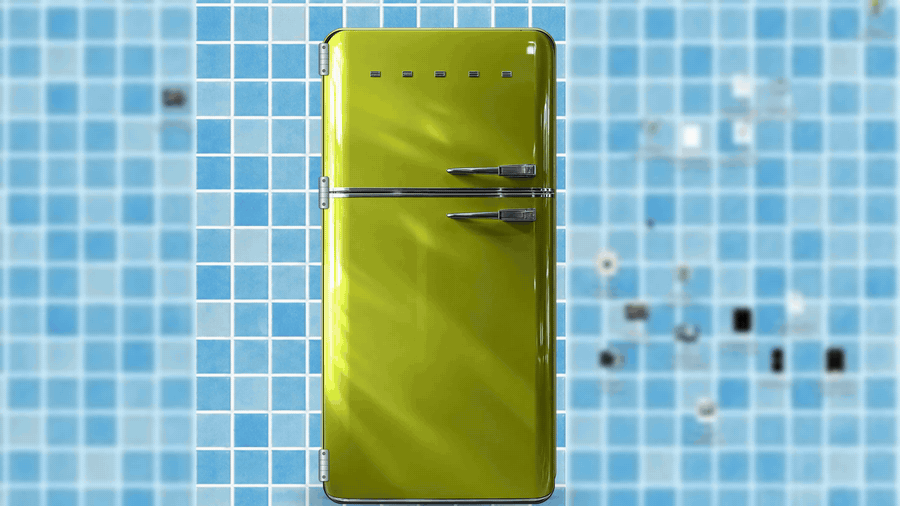
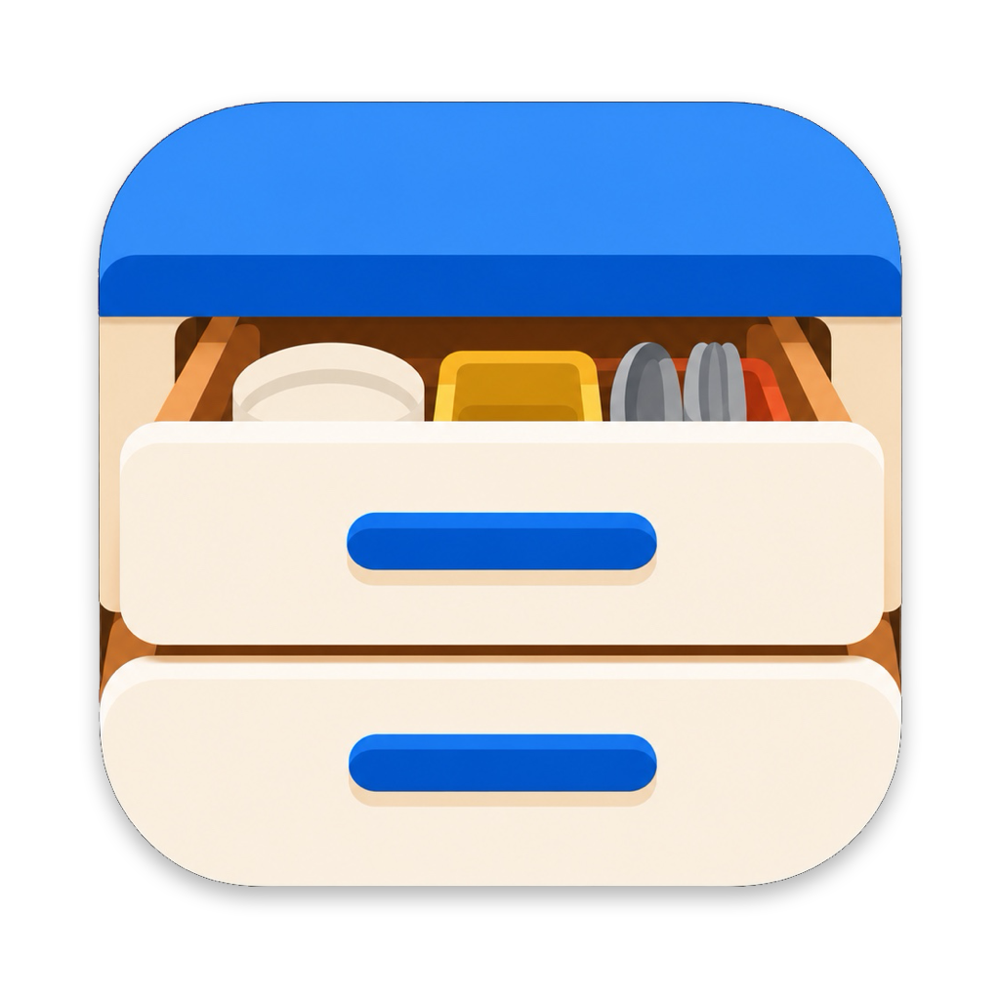
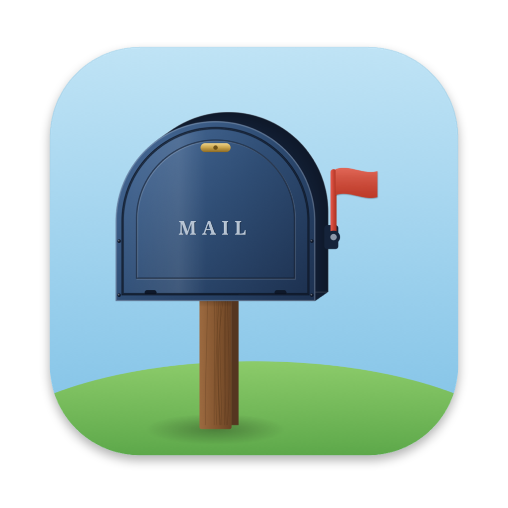
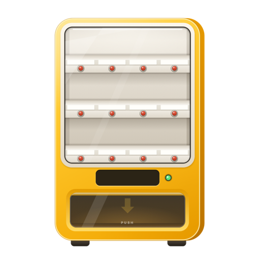
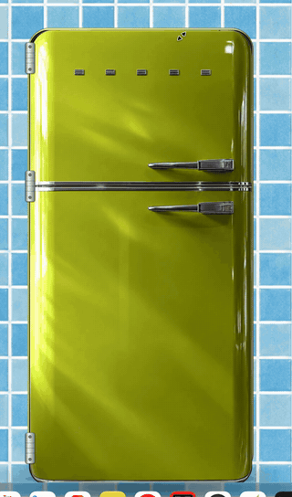
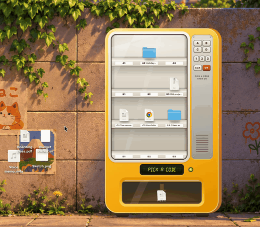
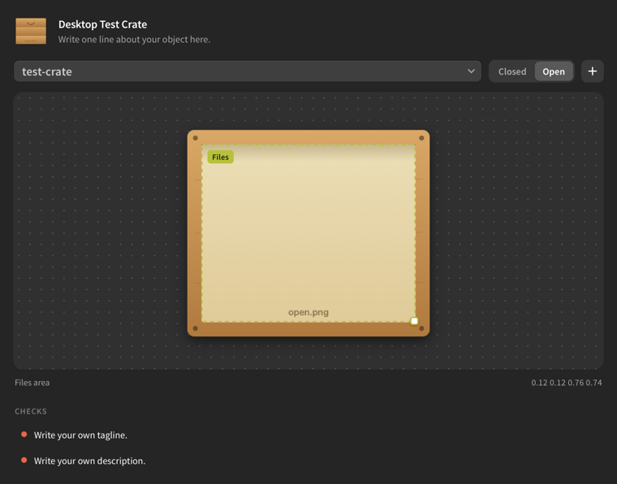

<h1 align="center">WhimsyDesk</h1>

<p align="center">
  
</p>

<p align="center">
  <a href="https://github.com/Electrofist/whimsydesk/actions/workflows/ci.yml"></a>
  
  
  <a href="LICENSE"></a>
  <a href="docs/make-your-own.md"></a>
  <a href="https://phcode.dev"></a>
  <a href="https://github.com/Electrofist/desktop-objects-phoenix"></a>
</p>

<p align="center">
  <b>Real-feeling objects that live on your Mac desktop and hold your files.</b><br>
  A fridge, a drawer, a mailbox and a vending machine. Drop files in, close them up, and your desktop is clear.<br>
  Open it again and everything is where you left it.
</p>

<p align="center">
  <a href="https://github.com/Electrofist/whimsydesk/releases/latest"><b>Download</b></a> &nbsp;·&nbsp;
  <a href="#the-objects">Objects</a> &nbsp;·&nbsp;
  <a href="#get-started">Get started</a> &nbsp;·&nbsp;
  <a href="docs/make-your-own.md">Make your own</a> &nbsp;·&nbsp;
  <a href="docs/faq.md">FAQ</a> &nbsp;·&nbsp;
  <a href="CONTRIBUTING.md">Contribute</a>
</p>

<br>

## The objects

Each object is a small, standalone Mac app. Free, open source and made to be remixed.

<table>
  <tr>
    <td align="center" width="25%">
      <br>
      <b>Desktop Fridge</b><br>
      <sub>A retro fridge with a heavy door, cold fog and frost.</sub><br><br>
      <a href="https://github.com/Electrofist/whimsydesk/releases/download/downloads/Desktop-Fridge.dmg"><b>Download</b></a> &nbsp;·&nbsp; <a href="#desktop-fridge">Details</a>
    </td>
    <td align="center" width="25%">
      <br>
      <b>Desktop Drawer</b><br>
      <sub>A wooden drawer tucked along the bottom of your screen.</sub><br><br>
      <a href="https://github.com/Electrofist/whimsydesk/releases/download/downloads/Desktop-Drawer.dmg"><b>Download</b></a> &nbsp;·&nbsp; <a href="#desktop-drawer">Details</a>
    </td>
    <td align="center" width="25%">
      <br>
      <b>Desktop Mailbox</b><br>
      <sub>A post box where a letter arrives every now and then.</sub><br><br>
      <a href="https://github.com/Electrofist/whimsydesk/releases/download/downloads/Desktop-Mailbox.dmg"><b>Download</b></a> &nbsp;·&nbsp; <a href="#desktop-mailbox">Details</a>
    </td>
  </tr>
  <tr>
    <td align="center" width="25%">
      <br>
      <b>Desktop Vending Machine</b><br>
      <sub>Files on little shelves. Press a button and one drops.</sub><br><br>
      <a href="https://github.com/Electrofist/whimsydesk/releases/download/downloads/Desktop-Vending-Machine.dmg"><b>Download</b></a> &nbsp;·&nbsp; <a href="#desktop-vending-machine">Details</a>
    </td>
    <td align="center" width="25%">
      <br>
      <b>Desktop Vending Machine Keypad</b><br>
      <sub>The same machine with a keypad. Type a code and one drops.</sub><br><br>
      <a href="https://github.com/Electrofist/whimsydesk/releases/download/downloads/Desktop-Vending-Machine-Keypad.dmg"><b>Download</b></a> &nbsp;·&nbsp; <a href="#desktop-vending-machine">Details</a>
    </td>
    <td align="center" width="25%">
      <a href="docs/make-your-own.md"></a><br>
      <b>Your object</b><br>
      <sub>An oven, a toolbox, a plant pot. Bring the art; the template does the rest.</sub><br><br>
      <a href="docs/make-your-own.md"><b>Make your own</b></a> &nbsp;·&nbsp; <a href="#in-phoenix-code-recommended">In Phoenix Code</a>
    </td>
  </tr>
</table>

### Desktop Fridge

<p align="center">
  
  &nbsp;
  
</p>

Drag files in, shut the door, forget about them. Open it again and they are right where you left them, maybe a little frostier.

- **A heavy door.** Grab it anywhere and swing it. It stays where you leave it and only drifts shut when it is barely open.
- **Cold inside.** Fog spills out as it opens. Files left for days slowly frost over.
- **Notes and magnets.** ⌘-click the door for a sticky note, or drop a photo on it to pin it under a magnet.
- **Put Back.** Any file goes back where it came from, even to its old spot on your desktop.

<sub>Stores files in <code>~/Fridge</code> &nbsp;·&nbsp; <a href="objects/fridge/README.md">How to use it</a> &nbsp;·&nbsp; <a href="https://github.com/Electrofist/whimsydesk/releases/download/downloads/Desktop-Fridge.dmg">Download</a></sub>

### Desktop Drawer

<p align="center">
  
</p>

A worn wooden drawer that lives along the bottom of your screen. Slide it out, drop files in, push it shut.

- **Weight.** Friction, soft bumpers and a little bounce when it hits the stop.
- **Sound.** Wooden knocks and a sliding rumble that follows your hand.
- **Put Back.** Files go back to their exact spot on your desktop.

<sub>Stores files in <code>~/Desktop Drawer</code> &nbsp;·&nbsp; <a href="https://github.com/Electrofist/whimsydesk/releases/download/downloads/Desktop-Drawer.dmg">Download</a></sub>

### Desktop Mailbox

<p align="center">
  
  
  
</p>

A red post box on a pole. Every now and then a letter arrives through the slot and waits there until you read it.

- **Letters.** Handpicked notes, films, books and songs, plus short real letters from people long ago. Never ads, never paid for. Choose how often they come, or pause them.
- **The envelope opens.** The wax seal pops, the flap folds back and the letter slides out. You can write back; replies stay on your Mac.
- **Your letters.** Click the envelope on the front of the box to see every letter that has come.
- **A hiding spot.** Drop up to 24 files in and close the door. Put Back returns each one to where it was.

<sub>Stores files in <code>~/Mailbox</code> &nbsp;·&nbsp; <a href="objects/mailbox/README.md">How to use it</a> &nbsp;·&nbsp; <a href="https://github.com/Electrofist/whimsydesk/releases/download/downloads/Desktop-Mailbox.dmg">Download</a></sub>

### Desktop Vending Machine

<p align="center">
  
</p>

<p align="center">
  
  
</p>

A sunny little vending machine that stands on your desktop. Your files are the snacks, each on a shelf behind the glass with its name on a tag. It comes in two versions; pick one, or run both.

- **Buttons.** Press the red button under a file and it is pushed off its shelf into the bin.
- **Keypad.** Type a code like B2, press OK, and that file drops.
- **Take it out.** Drag a file out of the bin, or right-click and choose Put Back to return it to where it was.
- **Twelve spots.** Drag files onto the window and outlines show where they will stand. When it is full, the screen says SOLD OUT.

<sub>Buttons: stores files in <code>~/Vending Machine</code> &nbsp;·&nbsp; <a href="objects/vending/README.md">How to use it</a> &nbsp;·&nbsp; <a href="https://github.com/Electrofist/whimsydesk/releases/download/downloads/Desktop-Vending-Machine.dmg">Download</a><br>
Keypad: stores files in <code>~/Vending Machine Keypad</code> &nbsp;·&nbsp; <a href="objects/vending-keypad/README.md">How to use it</a> &nbsp;·&nbsp; <a href="https://github.com/Electrofist/whimsydesk/releases/download/downloads/Desktop-Vending-Machine-Keypad.dmg">Download</a></sub>

## Get started

### Download

<p>
  <a href="https://github.com/Electrofist/whimsydesk/releases/download/downloads/Desktop-Fridge.dmg"></a>
  <a href="https://github.com/Electrofist/whimsydesk/releases/download/downloads/Desktop-Drawer.dmg"></a>
  <a href="https://github.com/Electrofist/whimsydesk/releases/download/downloads/Desktop-Mailbox.dmg"></a>
  <a href="https://github.com/Electrofist/whimsydesk/releases/download/downloads/Desktop-Vending-Machine.dmg"></a>
  <a href="https://github.com/Electrofist/whimsydesk/releases/download/downloads/Desktop-Vending-Machine-Keypad.dmg"></a>
</p>

Click a button and the download starts. Open the file, drag the app into **Applications**, and open it from there. Free, for macOS 14 or later.

The first time, macOS may say the app cannot be opened, because it is not registered with Apple yet. Click **Done**, open **System Settings → Privacy & Security**, and click **Open Anyway**. You only do this once. Step-by-step help with every object is on the [Downloads page](https://github.com/Electrofist/whimsydesk/releases/latest).

### Build from source

You need macOS 14 or later and Apple's Command Line Tools (`xcode-select --install`).

```sh
git clone https://github.com/Electrofist/whimsydesk.git
cd whimsydesk/objects/fridge
./build.sh run
```

For the drawer: `cd objects/drawer && bash build_app.sh`, then open `build/Desktop Drawer.app`. For the mailbox: `cd objects/mailbox && ./build.sh run`. For the vending machines: `cd objects/vending && ./build.sh run` (or `objects/vending-keypad`).

Questions about where files go, permissions or the "cannot be opened" warning are answered in the [FAQ](docs/faq.md).

## Every object promises

- **Your files are moved, never copied or deleted,** into a normal folder you can open in Finder.
- **Put Back** returns a file to where it came from.
- **Quiet at rest.** No timers and no polling while nobody is touching it.
- **Private.** No network, no tracking, no accounts.

## Make your own

### In Phoenix Code (recommended)



[Phoenix Code](https://phcode.dev) is a free editor, and with the [Desktop Objects Studio](https://github.com/Electrofist/desktop-objects-phoenix) extension, making an object is visual. You can do the whole thing without leaving it.

1. Install [Phoenix Code](https://phcode.dev). In its Extension Manager, install **Desktop Objects Studio**.
2. Fork this repo on GitHub, then in Phoenix Code choose **Start Project, Get from Git** and paste your fork's URL.
3. Choose **File, New Desktop Object…** and give it a name. Your object is ready to build.
4. Open the Desktop Objects panel from the right-hand toolbar. Swap in your art and watch it update. Drag the dashed box to set where files sit. Problems in `object.json` are marked as you type.
5. Open Phoenix Code's terminal panel and run `cd objects/your-object && bash build.sh run` to see it on your desktop.
6. Commit and push with Phoenix Code's Git panel, then open a pull request.

<br clear="right">

### From Terminal

```sh
scripts/new-object.sh "Air Fryer" your-github-username
cd objects/air-fryer && ./build.sh run
```

That puts a working object on your desktop. Swap in your art, describe it, and open a pull request.

Either way, the [step-by-step guide](docs/make-your-own.md) is written for designers who have never touched Swift.

## Repo layout

```
objects/            one folder per object, each a standalone app
  fridge/
  drawer/
  mailbox/
  vending/
  vending-keypad/
templates/object/   the starter object used by new-object.sh
scripts/            new-object.sh, check-objects.sh, make-icon.swift, release tools
docs/               make-your-own guide, FAQ, releasing
```

## Community

- Ideas for new objects: open an [issue](https://github.com/Electrofist/whimsydesk/issues/new/choose) or start a [discussion](https://github.com/Electrofist/whimsydesk/discussions).
- Contributing: [CONTRIBUTING.md](CONTRIBUTING.md). Be kind: [CODE_OF_CONDUCT.md](CODE_OF_CONDUCT.md).
- Security: [SECURITY.md](SECURITY.md).

## License

[MIT](LICENSE) for everything in this repo unless an object's `object.json` says otherwise.

<br>

<p align="center"><sub>Started by <a href="https://github.com/Electrofist">Krrish Parmar</a> with a fridge. Built by everyone who adds an object. Made with <a href="https://phcode.dev">Phoenix Code</a>.</sub></p>
