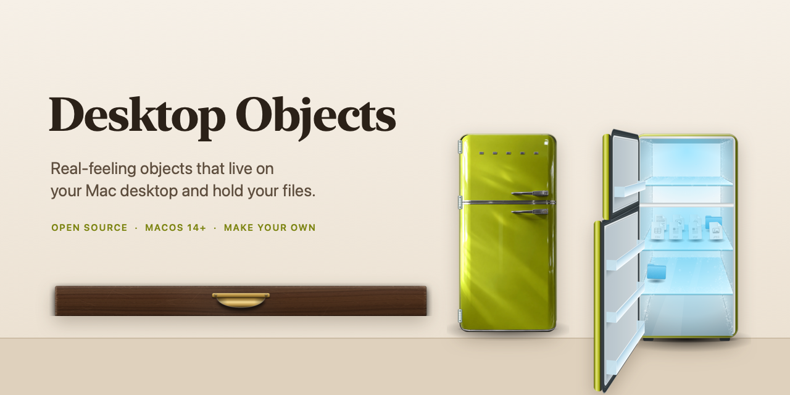
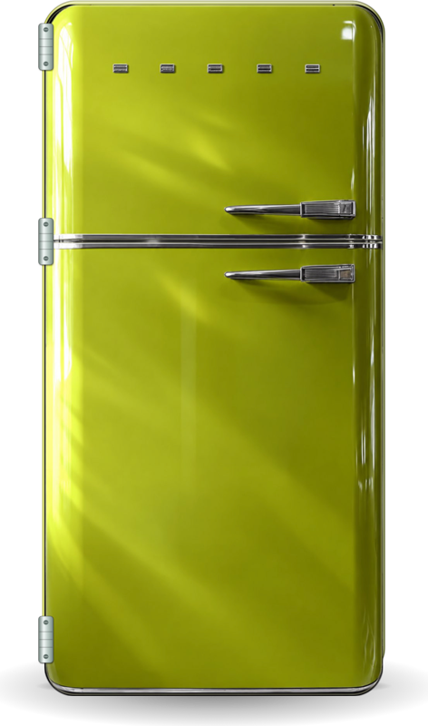
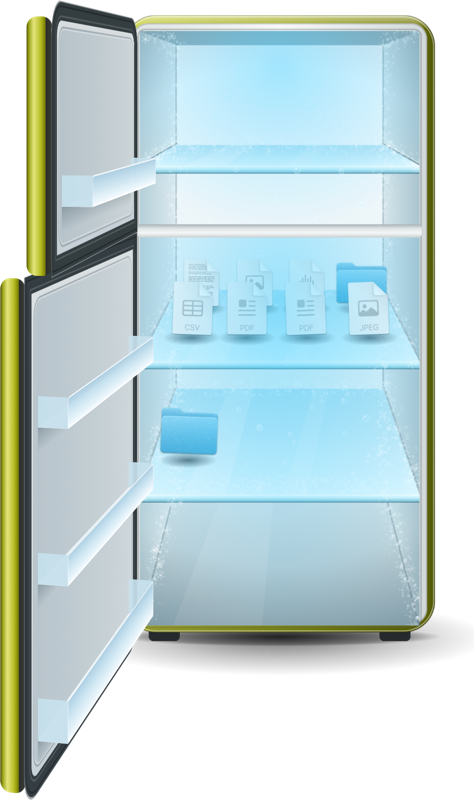
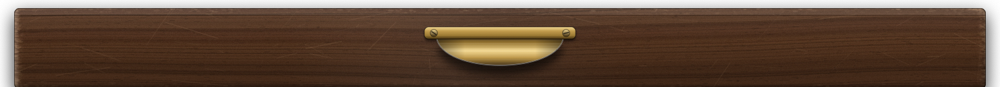
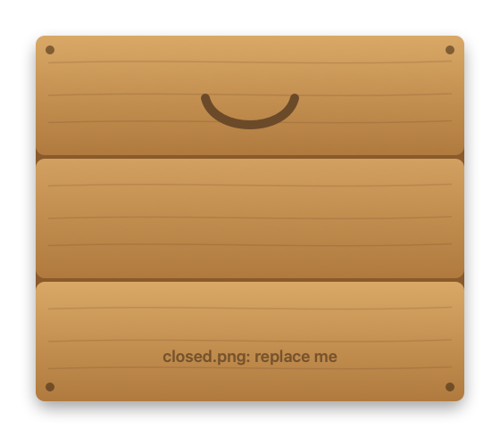

<p align="center">
  
</p>

<p align="center">
  <a href="https://github.com/Electrofist/desktop-objects/actions/workflows/ci.yml"></a>
  
  
  <a href="LICENSE"></a>
  <a href="docs/make-your-own.md"></a>
</p>

<p align="center">
  <b>Real-feeling objects that live on your Mac desktop and hold your files.</b><br>
  Drag a file into the fridge, shut the door, and your desktop is clear.<br>
  Open it again and everything is where you left it.
</p>

<p align="center">
  <a href="https://github.com/Electrofist/desktop-objects/releases/latest"><b>Download</b></a> &nbsp;·&nbsp;
  <a href="#the-objects">Objects</a> &nbsp;·&nbsp;
  <a href="#get-started">Get started</a> &nbsp;·&nbsp;
  <a href="docs/make-your-own.md">Make your own</a> &nbsp;·&nbsp;
  <a href="docs/faq.md">FAQ</a> &nbsp;·&nbsp;
  <a href="CONTRIBUTING.md">Contribute</a>
</p>

<br>

## The objects

Each object is a small, standalone macOS app. Free, open source and made to be remixed.

### Desktop Fridge

<p align="center">
  
  &nbsp;&nbsp;&nbsp;
  
</p>

A retro olive fridge with a freezer on top.

- **A door with weight.** Grab it anywhere and swing it. Hinge friction holds it open; it only drifts shut when barely open.
- **Cold.** Fog spills out when it opens, and frost slowly builds on files you leave inside for days.
- **Notes and magnets.** ⌘-click the door for a sticky note. Drop a photo on it to pin it under a magnet.
- **Put Back.** Every file can go back where it came from, icon position included.

Files live in `~/Fridge`. &nbsp;[How to use it →](objects/fridge/README.md)

### Desktop Drawer

<p align="center">
  
</p>

A worn wooden drawer that slides out from the bottom of your screen.

- **Weight and feel.** Friction, soft bumpers and a little rebound at the stop.
- **Sound.** Wooden knocks and a sliding rumble that follows your hand.
- **Put Back.** Files return to where they were on your desktop.

Files live in `~/Desktop Drawer`.

### Your object here

<p align="center">
  
</p>

An oven for projects you are still cooking. A toolbox. A mailbox. Something that is not in a house at all. The template gives you a working object in one command, so you only bring the art. [Make your own →](docs/make-your-own.md)

## Get started

### Download

<p>
  <a href="https://github.com/Electrofist/desktop-objects/releases/download/downloads/Desktop-Fridge.dmg"></a>
  <a href="https://github.com/Electrofist/desktop-objects/releases/download/downloads/Desktop-Drawer.dmg"></a>
</p>

Click a button and the download starts. Open the file, drag the app into **Applications**, and open it from there. Free, for macOS 14 or later.

The first time, macOS may say the app cannot be opened, because it is not registered with Apple yet. Click **Done**, open **System Settings → Privacy & Security**, and click **Open Anyway**. You only do this once. Step-by-step help with every object is on the [Downloads page](https://github.com/Electrofist/desktop-objects/releases/latest).

### Build from source

You need macOS 14 or later and Apple's Command Line Tools (`xcode-select --install`).

```sh
git clone https://github.com/Electrofist/desktop-objects.git
cd desktop-objects/objects/fridge
./build.sh run
```

For the drawer: `cd objects/drawer && bash build_app.sh`, then open `build/Desktop Drawer.app`.

Questions about where files go, permissions or the "cannot be opened" warning are answered in the [FAQ](docs/faq.md).

## Every object promises

- **Your files are moved, never copied or deleted,** into a normal folder you can open in Finder.
- **Put Back** returns a file to where it came from.
- **Quiet at rest.** No timers and no polling while nobody is touching it.
- **Private.** No network, no tracking, no accounts.

## Make your own

```sh
scripts/new-object.sh "Air Fryer" your-github-username
cd objects/air-fryer && ./build.sh run
```

That puts a working object on your desktop. Swap in your art, describe it, and open a pull request. The [step-by-step guide](docs/make-your-own.md) is written for designers who have never touched Swift.

## Repo layout

```
objects/            one folder per object, each a standalone app
  fridge/
  drawer/
templates/object/   the starter object used by new-object.sh
scripts/            new-object.sh, check-objects.sh
docs/               make-your-own guide, FAQ, releasing
```

## Community

- Ideas for new objects: open an [issue](https://github.com/Electrofist/desktop-objects/issues/new/choose) or start a [discussion](https://github.com/Electrofist/desktop-objects/discussions).
- Contributing: [CONTRIBUTING.md](CONTRIBUTING.md). Be kind: [CODE_OF_CONDUCT.md](CODE_OF_CONDUCT.md).
- Security: [SECURITY.md](SECURITY.md).

## License

[MIT](LICENSE) for everything in this repo unless an object's `object.json` says otherwise.

<br>

<p align="center"><sub>Started by <a href="https://github.com/Electrofist">Krrish Parmar</a> with a fridge. Built by everyone who adds an object.</sub></p>
