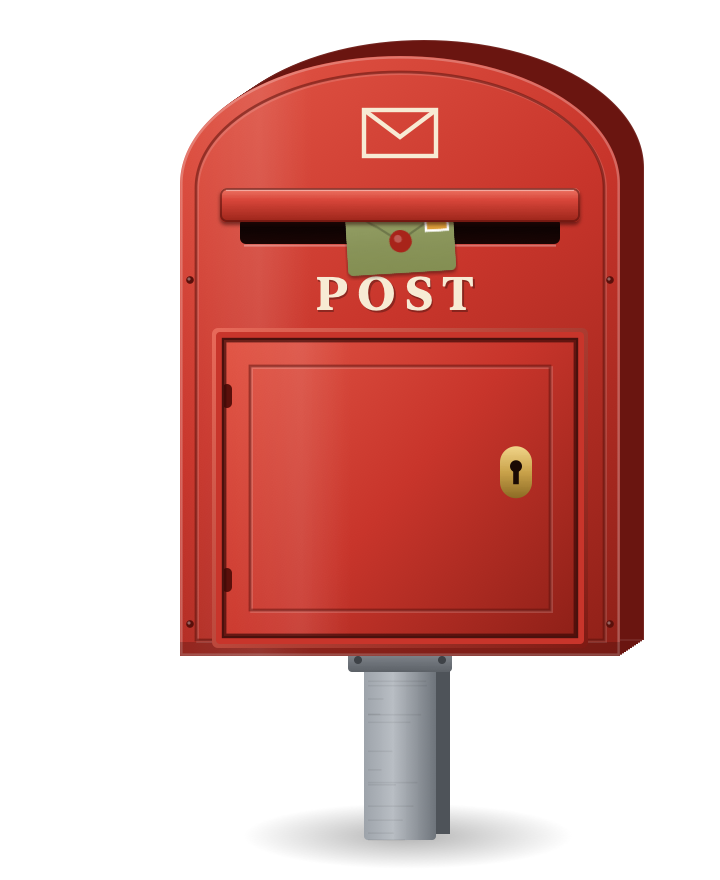
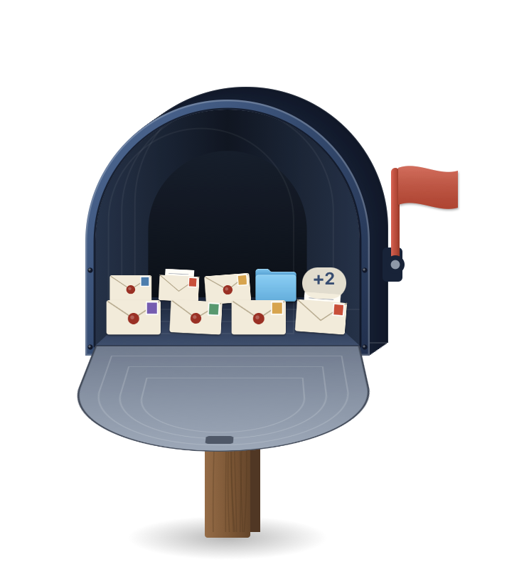
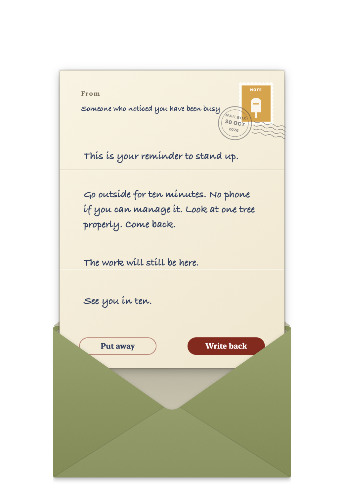

# Desktop Mailbox

A red post box that lives on your desktop. Every now and then a letter arrives: a note, a movie for tonight, a book, a song, a few good words. It slides in through the slot and waits there, sticking out, until you read it. You can write back.

<p align="center">
  
  
  
</p>

It is also a hiding spot. Drop files in, close the door, and your desktop is clear.

## Using it

- **Open the door:** click the door. Or grab it and swing it. It slows on its hinges and bounces off its stop.
- **Close it:** click again, or push the door shut. The latch catches it.
- **Read a letter:** click the letter sticking out of the slot. It comes out in its envelope: the wax seal pops, the flap opens and the letter slides out. Letters you have read are under **Your Letters** in the right-click menu.
- **Write back:** press **Write back** on a letter. Your reply is kept on this Mac, in `~/Mailbox/.replies`. Nothing is sent anywhere.
- **Hide files:** drag files or folders onto the box. The door swings open and they land on the floor and the two shelves, as their own icons. It holds 24.
- **See a file:** click it to see its name. Press Space to preview it, like in Finder. Double-click to open it.
- **Take it back:** drag it out, or right-click and choose **Put Back** to return it to where it came from, even its old spot on the desktop.
- **Move it:** hold Option and Command and drag.
- **Resize it:** hold Option and drag up to grow it or down to shrink it.
- **Taller or shorter pole:** hold Shift and drag up or down.
- **How often letters come:** right-click, then **Letters**. About once a day, a few times a week, about once a week, or paused.
- **Clean up:** press **Throw away** on a letter, or right-click and choose **Throw Away Read Letters**.
- **Everything else:** right-click the mailbox. Sound on or off, open the folder, see when more mail is coming, quit.

## How the mail works

All letters ship inside the app, in [`Resources/letters.json`](Resources/letters.json). They are picked by hand. They are never ads, and nobody pays to be in them. There is no internet, no account and no tracking. The first letter arrives on first launch. After that, a new one arrives at a random time during the daytime, as often as you choose. Each letter comes once. When all of them have arrived, the deliveries stop.

The mailbox keeps one alarm for the next delivery and does nothing else while you are not touching it.

### Adding your own letters

Each letter looks like this:

```json
{
  "id": "totoro",
  "from": "Someone who still believes in forest spirits",
  "kind": "movie",
  "title": "My Neighbor Totoro (1988)",
  "body": "If you have had a long week, this is the cure.",
  "signoff": "Bring an umbrella."
}
```

- `id`: short and unique. Never reuse an id; it is how the mailbox remembers what it already delivered.
- `kind`: `note`, `movie`, `book`, `song` or `quote`. It sets the stamp colour.
- `title` and `signoff` are optional. Use `\n` for a new line.
- One letter can have `"welcome": true` to arrive first.

Rebuild after editing.

## Build

```sh
./build.sh        # builds "build/Desktop Mailbox.app" for Apple silicon and Intel
./build.sh run    # builds and opens it
```

To try deliveries quickly, run the app with `MAILBOX_DELIVERY_SECONDS=20` set and a letter arrives every 20 seconds:

```sh
MAILBOX_DELIVERY_SECONDS=20 "build/Desktop Mailbox.app/Contents/MacOS/DesktopMailbox"
```

## Sounds

Every sound is made in code, so there are no audio files to license. To use a recording instead, put a WAV file in `Resources/Sounds/` with one of these names and rebuild: `clunk` (door shuts), `thud` (door hits its stop), `creak` (hinge), `arrive` (a letter comes through the slot), `seal` (the wax seal pops), `rustle` (paper), `drop` (something lands inside).

## Where things are kept

- `~/Mailbox`: your hidden files, as normal files you can open in Finder.
- `~/Mailbox/.mailbox-index.json`: where each file came from, for Put Back.
- `~/Mailbox/.mailbox-post.json`: which letters have arrived and when the next one is due.
- `~/Mailbox/.replies`: your replies, one text file per letter.

## Art

The art is drawn in code in `Sources/DesktopMailbox/MailboxArt.swift`. Painted art can replace it piece by piece: see [`Resources/Art/README.md`](Resources/Art/README.md). To export the code-drawn art:

```sh
swift build
.build/debug/DesktopMailbox --render-closed closed.png
.build/debug/DesktopMailbox --render-icon icon-art.png
swift ../../scripts/make-icon.swift icon-art.png Resources   # app icon
```
