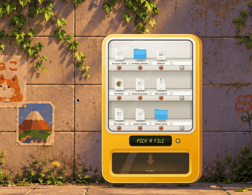

<p align="center"></p>

# Desktop Vending Machine

A little vending machine that stands on your desktop. Your files are the snacks, each standing on a shelf behind the glass with its name on a tag. Press the button under one and it is pushed off the shelf and drops into the bin.

<p align="center">
  
</p>

The art is a placeholder drawn in code for now. Painted art can replace it piece by piece; see `Resources/Art/README.md`.

Made by [Electrofist](https://github.com/Electrofist). Part of [Desktop Objects](../../README.md).

## Use it

- Drag files or folders onto the window. Outlines show where they will stand, and each one moves into `~/Vending Machine`. Twelve spots; when they are full, the screen says SOLD OUT.
- Point at a file or its button to see its name on the screen.
- Press the red button under a file. It is pushed off its shelf and falls into the bin. Double-clicking a file does the same.
- Drag a file out of the bin onto the desktop or any folder to take it out. Files left in the bin stay there.
- Click a file to see its name. Press Space to look at it in Quick Look.
- Right-click a file and choose Put Back to send it back where it came from.
- Right-click anywhere for Vend, Open Vending Machine Folder, Put Back All, Sound and Quit.
- Hold Option and Command and drag to move the machine. It remembers where you left it.
- Hold Option and drag to make it bigger or smaller.

## Build

```sh
./build.sh run
```

Needs macOS 14 or later and Swift 5.9 or later.
